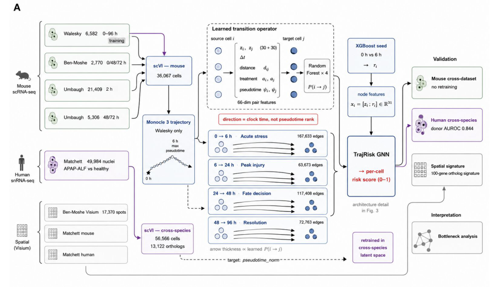
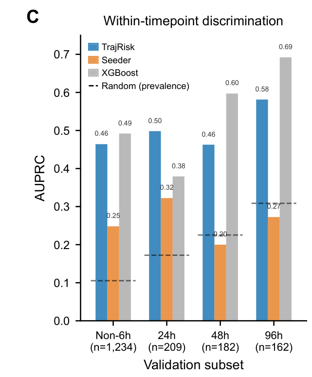

# TrajRisk

[](environments/README.md)
[](https://github.com/favourigwezeke/TrajRisk/releases)
[](https://github.com/favourigwezeke/TrajRisk/actions/workflows/validate.yml)
[](https://github.com/favourigwezeke/TrajRisk/actions/workflows/reproduce.yml)
[](LICENSE)

**Mapping hepatocyte states and candidate transitions across liver injury and recovery.**

## Overview

TrajRisk learns directed, treatment-aware transition graphs and integrates expression-derived features through a multiscale graph neural network. It was built for single-cell studies of acetaminophen-induced liver injury and recovery.

The TrajRisk score estimates normalized Monocle 3 pseudotime in the mouse injury–recovery reference.



*Study design and model workflow (Figure 1A).*

## Key features

- **Four temporal scales:** acute stress, peak injury, fate decision and resolution, with transition weights learned by Random Forest classifiers.
- **Multiscale feature integration:** four graph branches combine latent expression features with an expression-derived seed score.
- **Reference projection:** `Reference-KNN` and `W_self-only` inference for external mouse cohorts and shared mouse–human coordinates.
- **Transition analysis:** graph flux, bottleneck identification and edge perturbations to nominate transitions for experimental follow-up.

<details>
<summary>How does TrajRisk compare with an expression-only baseline?</summary>

TrajRisk had higher average precision at 24 h. XGBoost had higher average precision in the pooled non-6 h, 48 h, and 96 h subsets.



*Within-timepoint discrimination (Figure 4C).*

</details>

## Installation

The study workflow uses Python 3.12 on Linux CPU. Run:

```bash
git clone https://github.com/favourigwezeke/TrajRisk.git
cd TrajRisk

python3.12 -m venv .venv
source .venv/bin/activate
python -m pip install torch==2.10.0 --index-url https://download.pytorch.org/whl/cpu
python -m pip install -r environments/frozen-linux-py312.lock.txt
```

See [software environments](environments/README.md) for preprocessing, training and R dependencies.

## Quick start

Download the versioned model inputs with [GitHub CLI](https://cli.github.com/), then run the analysis:

```bash
mkdir -p build/downloads
gh release download v0.1.0-rc1 --repo favourigwezeke/TrajRisk \
  --pattern TrajRisk_frozen_inputs.zip --dir build/downloads

bash scripts/reproduce_saved.sh build/downloads/TrajRisk_frozen_inputs.zip
```

Without GitHub CLI, [download the input ZIP](https://github.com/favourigwezeke/TrajRisk/releases/download/v0.1.0-rc1/TrajRisk_frozen_inputs.zip) and pass its path to the same command. The download is public.

This command evaluates the released models, including the corrected Umbaugh 2 h analysis, and runs 87 numerical comparisons. It rebuilds all 20 CSV components of Tables S1–S6 from computed and archived results, generates Figures S1–S5, and redraws the main data panels listed in the [reproduction guide](docs/reproduction.md). Outputs go to `build/`.

For preprocessing and training from source datasets, follow the [analysis workflow](docs/workflow.md).

## Documentation

| Resource | Contents |
| --- | --- |
| [Study datasets](docs/datasets.md) | External data sources and accession information. |
| [Preprocessing notebooks](notebooks/README.md) | Dataset preparation, integration and trajectory inference. |
| [Analysis workflow](docs/workflow.md) | Graph construction, training, evaluation and figure scripts. |
| [Reproduction guide](docs/reproduction.md) | Commands, expected outputs and figure/table coverage. |
| [Supplementary data dictionary](docs/data_dictionary.md) | Fields, units and descriptions for Data S1–S5. |
| [Manuscript](manuscript/) | LaTeX source, figure exports, supplementary tables and data. |
| [Study inputs](docs/frozen_inputs.md) | Public download and contents of the model-input archive. |

## Citation

Cite the accompanying manuscript and record the code release or commit used. Citation metadata is in [CITATION.cff](CITATION.cff).

## License

Distributed under the MIT License. See [LICENSE](LICENSE) for the full terms.

## Contact

Email: [favour.igwezeke.249461@unn.edu.ng](mailto:favour.igwezeke.249461@unn.edu.ng).

For software or reproduction issues, open a [GitHub issue](https://github.com/favourigwezeke/TrajRisk/issues).
